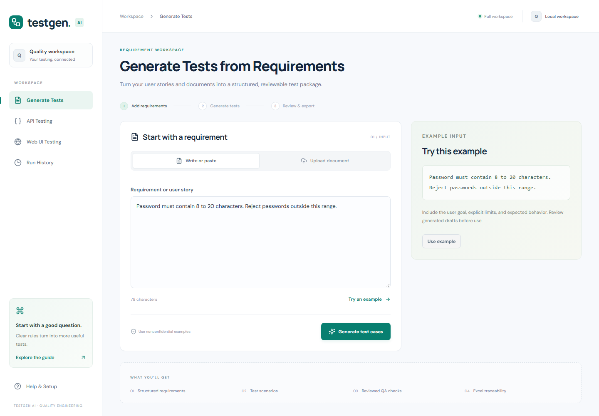
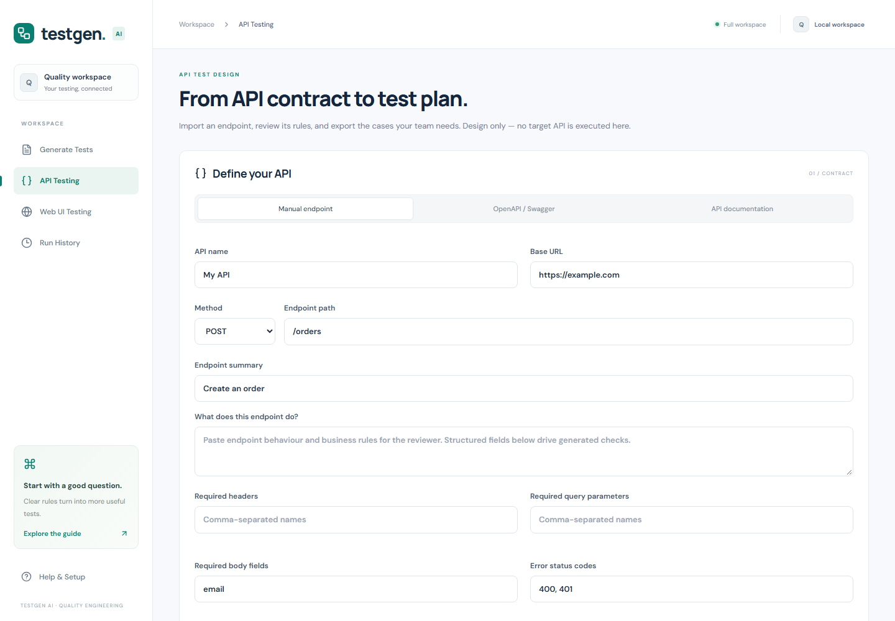
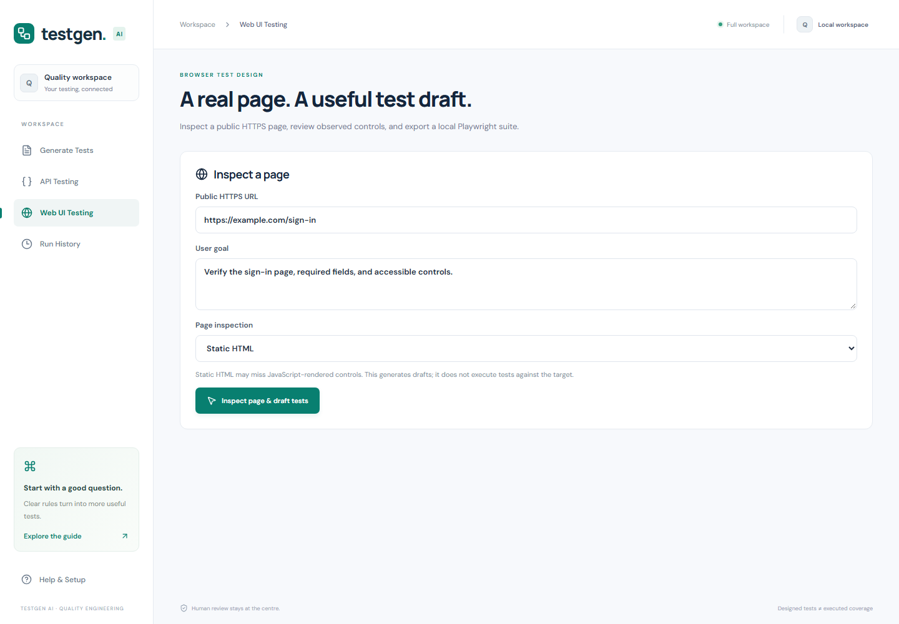
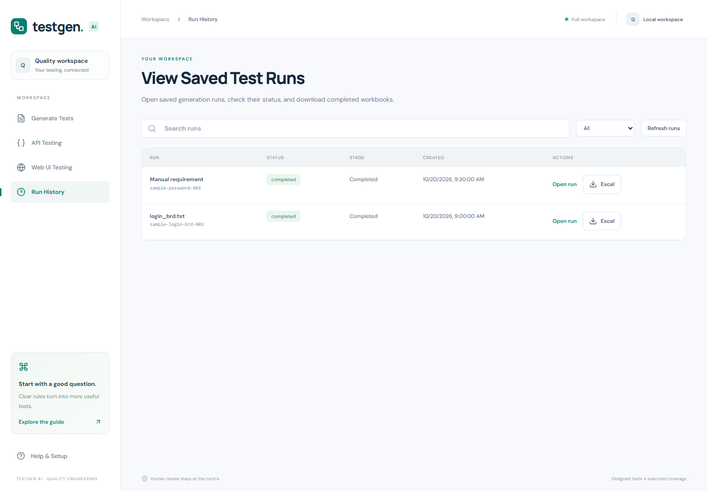
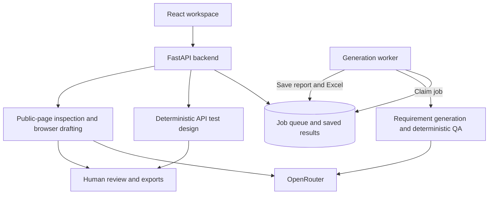

# TestGen AI

An AI-assisted test design workspace for QA engineers, developers, and learners.
Turn requirements, API contracts, and public web pages into structured, reviewable test designs using a React interface and Python backend.

**Example:** enter “Password must contain 8–20 characters” to generate requirement analysis, positive/negative/boundary scenarios, detailed cases, quality checks, and an Excel workbook.

Generated tests need human review. Design counts are not executed coverage: exported suites run separately against your application.

## What can I do with it?

| React page | Your input | What you get |
| --- | --- | --- |
| Generate Tests | A requirement or TXT, DOCX, text-based PDF | Analysis, scenarios, cases, validation, metrics, and Excel traceability |
| API Testing | Manual endpoint, OpenAPI 3.0/3.1 JSON/YAML, or HTML/API documentation | Deterministic test designs, editable expectations, field traceability, Excel/Postman/Pytest/experimental SoapUI exports |
| Web UI Testing | Public HTTPS URL and testing goal | Observed page controls, AI-assisted test drafts, review, and Playwright pytest ZIP |
| Run History | Previously submitted requirement-generation jobs | Saved status, results, and workbook downloads |
| Help & Setup | Backend configuration and optional workspace token | Setup guidance and workspace recovery |

Requirement generation and browser drafting use OpenRouter. API test design does not require an AI call. Only requirement-generation jobs are saved in history; API/browser drafts remain in tab memory and clear on reload.

Use fictional or nonconfidential examples. Requirement/document content and page summaries used for AI drafting are sent to the configured provider. Provider keys stay on the backend.

## React UI screenshots

Actual local React screens with fictional inputs. Run History uses synthetic sample records; API test design uses the local backend. No AI-provider calls were made for these captures.

### Generate Tests



### API Testing



### Web UI Testing



### Run History



## Understand the architecture



See [architecture details](docs/architecture.md) and [interactive architecture and sequence diagrams](docs/diagrams/README.md). GitHub previews the Mermaid diagram above; download an interactive HTML file and open it in a browser to explore or export it.

## Before you fork

- **Tested environment:** Windows PowerShell, Python 3.14, Node.js 24, and Git.
- A GitHub account is needed to create your own fork.
- An OpenRouter API key is needed for AI-powered workflows. Model availability and provider allowances vary.
- No hosting account or separate database server is required locally. SQLite is created automatically.
- This is a local QA tool with anonymous workspace isolation available as an option, not a full account/login system.
- There is no OCR, automatic execution in the React screens, or guarantee that generated tests fully cover business rules. API exports currently assert status codes; review them before execution.

## 1. Fork and clone

The React workspace is available on the default **`main`** branch.

1. Open [this repository](https://github.com/ShwetaGupta-AIQA/AI-TestCase-Generator).
2. Click **Fork**, keep the default `main` branch, then click **Create fork**.
3. Open PowerShell in a folder where you keep projects.
4. Replace `YOUR_GITHUB_USERNAME` with your GitHub username:

```powershell
git clone https://github.com/YOUR_GITHUB_USERNAME/AI-TestCase-Generator.git
cd AI-TestCase-Generator
```

All commands below start in this project folder unless stated otherwise. Forking gives you your own GitHub copy; cloning downloads it to your computer.

## 2. Install and configure the backend

```powershell
py -3.14 -m venv .venv
.\.venv\Scripts\python.exe -m pip install -r requirements.txt
Copy-Item .env.example .env
notepad .env
```

Copy the example only on a new setup; do not overwrite an existing `.env`.
Replace only `OPENROUTER_API_KEY=replace-me` with your own key for AI workflows.
Keep these local defaults:

```dotenv
OPENROUTER_MODEL=openrouter/free
TESTGEN_MODE=durable
TESTGEN_REQUIRE_WORKSPACE=false
TESTGEN_ENABLE_RENDERED_INSPECTION=false
```

Leave `DATABASE_URL` commented out to use SQLite. Never commit `.env`, paste keys into frontend files, or include them in screenshots. `.env` is ignored by Git.

## 3. Start three terminals

Keep all three running. Open each terminal in the project folder; no virtual-environment activation is required with the explicit Python paths below.

**Terminal 1 — FastAPI backend:**

```powershell
.\.venv\Scripts\python.exe -m uvicorn api.main:app --host 127.0.0.1 --port 8000
```

**Terminal 2 — generation worker:**

```powershell
.\.venv\Scripts\python.exe -m runs.worker
```

**Terminal 3 — React frontend:**

```powershell
cd frontend
npm.cmd ci
npm.cmd run dev
```

Open **http://127.0.0.1:5173** for the application.
Backend health: http://127.0.0.1:8000/health. API documentation: http://127.0.0.1:8000/docs.

React sends `/api` requests through Vite to port 8000. The worker processes queued generation jobs while the API serves status and results. Stop each process with **Ctrl+C**. On subsequent launches, repeat the three startup commands; dependency installation is only needed for setup or dependency changes.

## 4. Try your first requirement

1. Open **Generate Tests** and enter `Password must contain 8 to 20 characters.`
2. Submit once and wait for the job to complete.
3. Review the analysis, scenarios, accepted/rejected cases, quality checks, and traceability.
4. Download the Excel workbook.
5. Open **Run History** and reopen your result.

For document input, try `sample_documents/login_brd.txt`. The document workflow processes the first two extracted requirements; scanned PDFs need OCR first.

To explore without an AI key, use **API Testing** with a manual endpoint. Review its expected status codes and selected cases before exporting. Executable exports require confirmed 100–599 status codes. Browser drafting requires a public HTTPS page; private/local targets are not supported.

## What should I edit?

| Goal | Edit |
| --- | --- |
| Set provider key or model | Root `.env` only |
| Change React screens and styling | `frontend/src/` |
| Change backend endpoints | `api/main.py` |
| Change AI prompts | `prompts/` |
| Change deterministic checks | `qa_engine/`, `utils/` |
| Change API test generation | `services/api_test_designer.py` |
| Use a different local backend port | `frontend/.env.local`; see `frontend/.env.example`, then restart Vite |

For a normal first run, edit only `.env`. Do not edit source code or committed configuration to insert your key.

## Troubleshooting

| Problem | Check |
| --- | --- |
| Backend offline | Terminal 1 is running; open `/health` on port 8000 |
| Job stays queued | Terminal 2 is running from the project folder |
| AI generation fails | Backend provider key, selected model availability, and provider allowance |
| `py -3.14` is unavailable | Install Python 3.14 and reopen the terminal |
| React does not start | Node.js 24, successful `npm.cmd ci`, and port 5173 availability |
| Port already in use | Stop the other process; changing backend port also requires updating the Vite proxy |
| Document has no readable text | Use TXT, DOCX, or text-based PDF; OCR is not included |
| Rendered inspection unavailable | Use static inspection, or follow the optional Chromium setup |

Local history is stored in `output/testgen.db`; generated files use `output/runs/`. They persist across process restarts and are ignored by Git. Default local mode is shared and intended for trusted local use. Keep confidential documents out of public repositories.

## Optional Docker setup

With Docker and Compose installed, configure the root `.env` as above, then run:

```powershell
docker compose up --build
```

Open **http://127.0.0.1:5173**. Compose runs React, FastAPI, the worker, and PostgreSQL. Data uses Docker volumes rather than the local SQLite database. Stop with `docker compose down`; do not add `-v` unless you intend to remove stored volume data.

The legacy Streamlit interface is optional: `docker compose --profile legacy-ui up --build`, then open port 8501.

## Documentation and checks

- [React features, recovery, and configuration](docs/react-ui.md)
- [Architecture](docs/architecture.md) and [interactive diagrams](docs/diagrams/README.md)
- [CLI, tests, evaluation, and legacy Streamlit](docs/developer-guide.md)
- [Web UI inspection and optional Chromium](docs/web-ui-testing.md)
- [Export verification and limitations](docs/api-export-verification.md)
- [Screenshot capture guide](docs/images/README.md)

Backend regression tests use mocked AI responses; the golden evaluation runner makes live provider calls. Test results do not establish general AI accuracy. Full Docker-stack execution and real-provider quality must be verified independently; see the linked guides for recorded verification scope.
