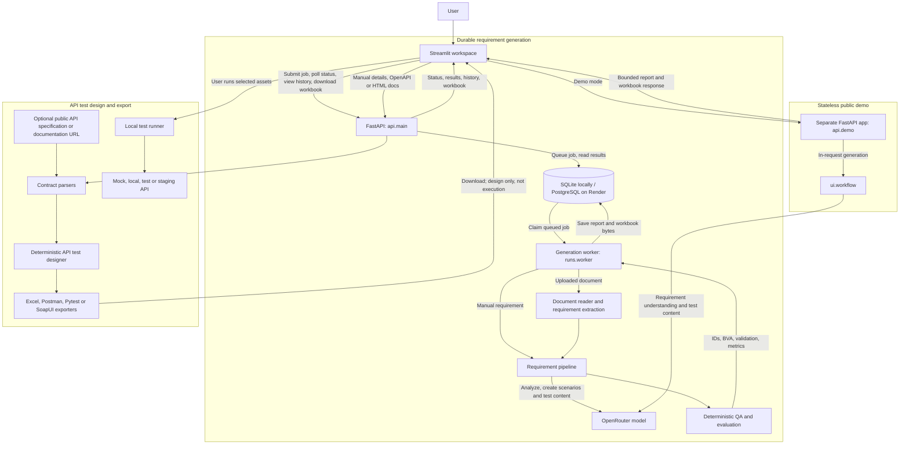

# TestGen AI System Architecture

TestGen AI has three related runtime paths: queued requirement generation,
bounded session-only demo generation, and synchronous API test design/export.

## Runtime Paths

### Durable requirement generation

The default workspace submits manual or document jobs to FastAPI. The API stores
queued jobs in the configured database; a separate worker claims them, runs the
generation pipeline, and saves the report and workbook bytes. The UI polls the
API for status and retrieves completed results. Local development defaults to
SQLite; the Render deployment uses PostgreSQL. Uploaded document bytes are stored
with the run so the worker does not depend on a shared filesystem.

### Stateless demo

The public demo uses the separate `api.demo:app` application. It calls the
generation workflow during the request and returns session-only results. It does
not use the durable run database or worker, and applies request, size, time and
generation limits.

### API test design and export

Manual endpoint details, OpenAPI documents and HTML API documentation are parsed
into an API contract. The designer creates deterministic test plans; this path
does not call the LLM. Exporters produce files for review and user-directed
execution. TestGen does not execute those exported tests against a target API.

## LLM and Deterministic Responsibilities

The LLM supports requirement understanding, scenario generation and test-case
content generation. Python code assigns IDs, calculates supported boundary values,
validates generated cases, evaluates quality metrics, parses API contracts and
designs API test plans. Structural and deterministic checks do not guarantee
semantic correctness or complete test coverage.

## Workspace Protection

The Render deployment enables signed anonymous workspace tokens to scope access
to saved runs. Local development defaults to trusted mode unless
`TESTGEN_REQUIRE_WORKSPACE=true` is set. These tokens do not provide user accounts
or a full identity provider.

